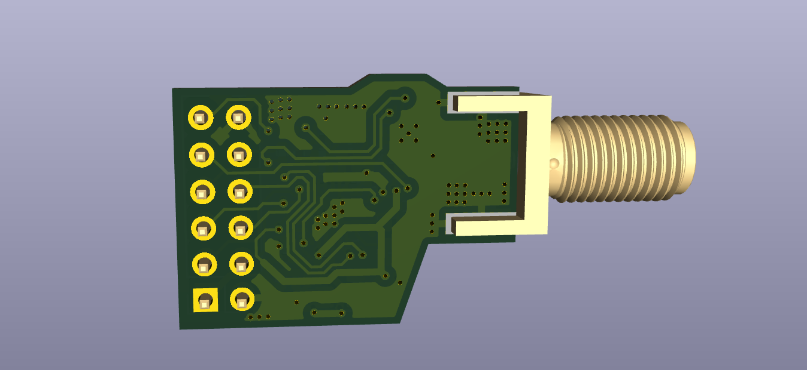
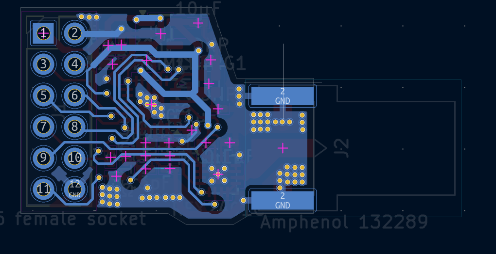

# ESP32-Transmitter-and-Receiver

This is designed as a custom ESP32 transmitter and receiver that can use LoRA (2.4 GHz), FLRC, and GFSK protocols. 

My initial goal for this project was to simply make a custom transmitter and receiver for my custom FPV drone, as it was originally using the PCB radio on an ESP-32, but soon grew into a very complex PCB routing and schematic design project. 

I learned lots of useful techniques in KiCAD and JLCPCB and part selection, such as routing, layering, vias, copper pours, and constraints with RF signal routing, which I will use in my future to make even more complex PCBs!

The radio amplifier and transceiver module is based on the SX1280IMLTRT transceiver IC and an RFX2401C RF front-end.

In order to fit the requirements on my drone, instead of putting bulky screw holes, my goal for the entire board was to make it as small and efficient as possible.

# PCB + Wiring Diagram

I used KiCAD, as it is free, unlike something like Altium Designer, to design the PCB, find parts, and make schematics.

## Schematic


Full schematic PDF: [Schematic Files/ESPNOW_Reciever_and_Transmitter.pdf](Schematic%20Files/ESPNOW_Reciever_and_Transmitter.pdf)

## PCB
Gerbers and drill files are in `PCB Gerbers/`.

### Backside


### Frontside


### Topside


### Bottom


## Wiring with Pins to ESP32 DevKit-C CP2012
| J1 Pin | Signal   | ESP32 GPIO | Notes                                        |
|:------:|----------|:----------:|----------------------------------------------|
| 1      | 5V       | 5V         | Power           |
| 2      | GND      | GND        |                                              |
| 3      | SCK      | GPIO18     | SPI clock (VSPI)                             |
| 4      | MISO     | GPIO19     | Output from SX1280                           |
| 5      | MOSI     | GPIO23     |                                              |
| 6      | NSS (CS) | GPIO5      |                                              |
| 7      | BUSY     | GPIO4      | Input to ESP32                               |
| 8      | DIO1     | GPIO27     | Interrupt input                              |
| 9      | RST      | GPIO13     |                                              |
| 10     | TXEN     | GPIO25     | To RFX2401C through R2                       |
| 11     | RXEN     | GPIO26     | To RFX2401C through R3                       |
| 12     | GND      | GND        | Connect both ground pins                     |


## BOM
[BOM.csv](https://github.com/user-attachments/files/35434525/BOM.csv)

## Additional Notes
Although this is a kind of uneventful and not world-changing project like some of the other ones, it was quite fun. A lot of my projects got rejected already :'(

The reason I will be using JLCPCB over PCBWay is due to the marketing and reputation of JLCPCB, and I can't manufacture the PCBs in-house as I don't have any experience with it or have the materials with assembly.

Also if there are files called ESP-NOW..., the project was unable to be renamed in KiCAD and I originally wanted it to use ESP-NOW, but that is a WiFi protocol and not LR enough.

I played Factorio a couple years back, beat it, played Krastorio and SE, and it was more similar than not to trace routing. Very fun to do, actually!

Antennas (Amazon): the receiver/drone antenna is the BOOBRIE 2.4GHz SMA male (B0991PKTDL), a 2-antenna pack, $6.68/pack ($3.34 each, better per-antenna rate than singles). One antenna per board, so 3 packs for 5 boards (1 spare). The transmitter/controller antenna is the HeelAooRC 2.4GHz ExpressLRS ES24TX Moxon (SMA plug, for the Micro TX module), also a 2-antenna pack, $14.99/pack, 1 pack for the controller (1 used, 1 spare).

I couldn't match the lapse times, as I work sporadically (work for 5 minutes, then play cs, then repeat), so a lot of the lapses don't represent all the work I did.

## No Fixes Needed Notes
U3 Schematic symbol is LT1761-1.2 but AP2112K-3.3 is placed
 - The PCB is fine, just the Schematic DRC has an error
C18/C19 wire is missing in schematic, connected at node and error in DRC, prod is fine.
U2 RFX2401C has no 3D model in the STEP, but just check the one in KiCAD
 - 3D model only affects the render and STEP export

## Test Code

**UNTESTED**

No Hackatime, as it's a pretty short and basic script.

Both use [RadioLib](https://github.com/jgromes/RadioLib) and the J1 pins above. Radio settings (2400 MHz, 812.5 kHz BW, SF9, CR 4/7) must match on both boards.

### Transmitter

```cpp
#include <RadioLib.h>

#define PIN_SCK   18
#define PIN_MISO  19
#define PIN_MOSI  23
#define PIN_NSS    5
#define PIN_DIO1  27
#define PIN_RST   13
#define PIN_BUSY   4
#define PIN_TXEN  25
#define PIN_RXEN  26

SX1280 radio = new Module(PIN_NSS, PIN_DIO1, PIN_RST, PIN_BUSY);

const int8_t TX_POWER_DBM = 0;

uint32_t counter = 0;

void setup() {
  Serial.begin(115200);
  SPI.begin(PIN_SCK, PIN_MISO, PIN_MOSI, PIN_NSS);

  radio.setRfSwitchPins(PIN_RXEN, PIN_TXEN);

  // 2400 MHz, 812.5 kHz BW, SF9, CR 4/7, private sync word
  int state = radio.begin(2400.0, 812.5, 9, 7, RADIOLIB_SX128X_SYNC_WORD_PRIVATE, TX_POWER_DBM);
  if (state != RADIOLIB_ERR_NONE) {
    Serial.print("SX1280 init failed, code ");
    Serial.println(state);
    while (true) delay(1000);
  }
  Serial.println("Transmitter ready");
}

void loop() {
  String msg = "Hello #" + String(counter++);
  int state = radio.transmit(msg);
  if (state == RADIOLIB_ERR_NONE) {
    Serial.print("Sent: ");
    Serial.println(msg);
  } else {
    Serial.print("Send failed, code ");
    Serial.println(state);
  }
  delay(1000);
}
```

### Receiver

```cpp
#include <RadioLib.h>

#define PIN_SCK   18
#define PIN_MISO  19
#define PIN_MOSI  23
#define PIN_NSS    5
#define PIN_DIO1  27
#define PIN_RST   13
#define PIN_BUSY   4
#define PIN_TXEN  25
#define PIN_RXEN  26

SX1280 radio = new Module(PIN_NSS, PIN_DIO1, PIN_RST, PIN_BUSY);

volatile bool packetReady = false;

void IRAM_ATTR onPacket() {
  packetReady = true;
}

void setup() {
  Serial.begin(115200);
  SPI.begin(PIN_SCK, PIN_MISO, PIN_MOSI, PIN_NSS);
  radio.setRfSwitchPins(PIN_RXEN, PIN_TXEN);

  int state = radio.begin(2400.0, 812.5, 9, 7, RADIOLIB_SX128X_SYNC_WORD_PRIVATE, 0);
  if (state != RADIOLIB_ERR_NONE) {
    Serial.print("SX1280 init failed, code ");
    Serial.println(state);
    while (true) delay(1000);
  }

  radio.setPacketReceivedAction(onPacket);
  radio.startReceive();
  Serial.println("Receiver listening");
}

void loop() {
  if (!packetReady) return;
  packetReady = false;

  String msg;
  int state = radio.readData(msg);
  if (state == RADIOLIB_ERR_NONE) {
    Serial.print("Got: ");
    Serial.print(msg);
    Serial.print("  RSSI ");
    Serial.print(radio.getRSSI());
    Serial.print(" dBm  SNR ");
    Serial.print(radio.getSNR());
    Serial.println(" dB");
  } else if (state == RADIOLIB_ERR_CRC_MISMATCH) {
    Serial.println("Packet with bad CRC");
  } else {
    Serial.print("Receive failed, code ");
    Serial.println(state);
  }
  radio.startReceive();
}
```
