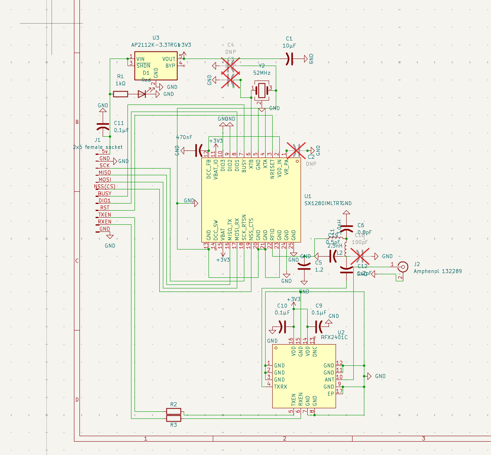
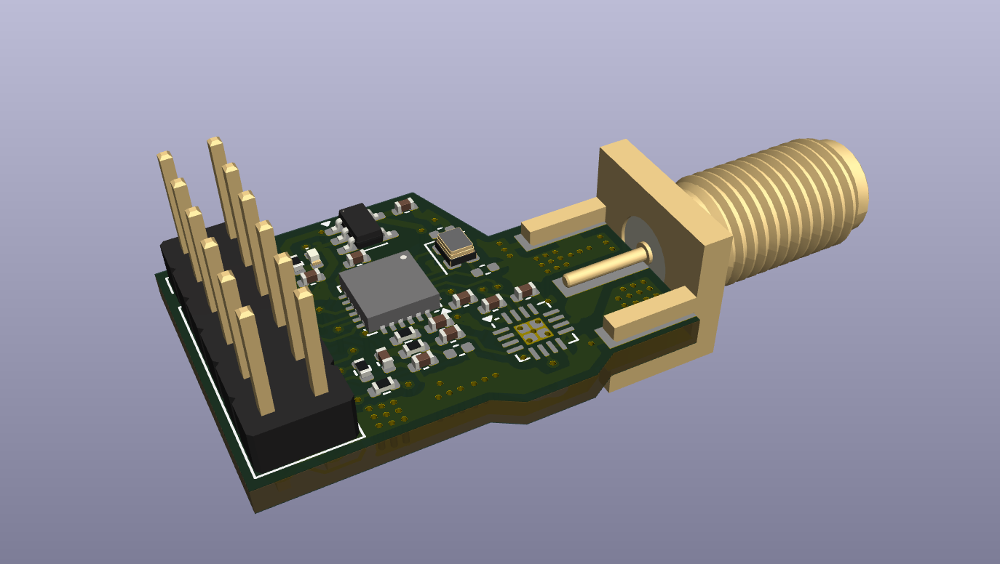
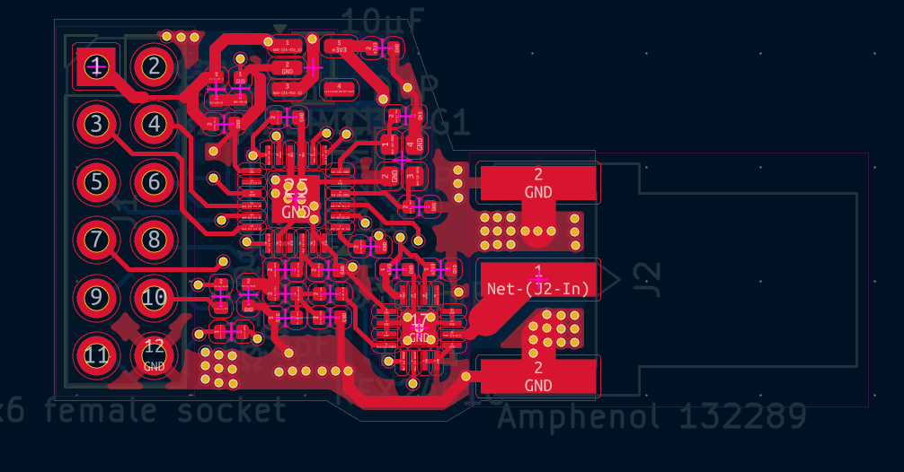

# ESP32-Transmitter-and-Receiver

This is designed as a custom ESP32 transmitter and receiver that can use LoRA (2.4 GHz), FLRC, and GFSK protocols. 

My initial goal for this project was to simply make a custom transmitter and receiver for my custom FPV drone, as it was originally using the PCB radio on an ESP-32, but soon grew into a very complex PCB routing and schematic design project. 

I learned lots of useful techniques in KiCAD and JLCPCB and part selection, such as routing, layering, vias, copper pours, and constraints with RF signal routing, which I will use in my future to make even more complex PCBs!

The radio amplifier and transceiver module is based on the SX1280IMLTRT transceiver IC and an RFX2401C RF front-end.

In order to fit the requirements on my drone, instead of putting bulky screw holes, my goal for the entire board was to make it as small and efficient as possible.

# PCB + Wiring Diagram

I used KiCAD, as it is free, unlike something like Altium Designer, to design the PCB, find parts, and make schematics.

## Schematic


Full schematic PDF: [Schematic Files/ESPNOW_Reciever_and_Transmitter.pdf](Schematic%20Files/ESPNOW_Reciever_and_Transmitter.pdf)

## PCB
Gerbers and drill files are in `PCB Gerbers/`.

### Backside


### Frontside


### Topside


### Bottom


## Wiring with Pins to ESP32 DevKit-C CP2012
| J1 Pin | Signal   | ESP32 GPIO | Notes                                        |
|:------:|----------|:----------:|----------------------------------------------|
| 1      | 5V       | 5V         | Power           |
| 2      | GND      | GND        |                                              |
| 3      | SCK      | GPIO18     | SPI clock (VSPI)                             |
| 4      | MISO     | GPIO19     | Output from SX1280                           |
| 5      | MOSI     | GPIO23     |                                              |
| 6      | NSS (CS) | GPIO5      |                                              |
| 7      | BUSY     | GPIO4      | Input to ESP32                               |
| 8      | DIO1     | GPIO27     | Interrupt input                              |
| 9      | RST      | GPIO13     |                                              |
| 10     | TXEN     | GPIO25     | To RFX2401C through R2                       |
| 11     | RXEN     | GPIO26     | To RFX2401C through R3                       |
| 12     | GND      | GND        | Connect both ground pins                     |


## BOM
Component lines come straight from the JLCPCB BOM matching export (2026-11-23); prices are what JLCPCB charges for the quantities it orders (minimum order quantities make the ordered qty higher than 5 per board).

| Designator | Value | Manufacturer | Part Number | JLCPCB Part # | Description | Qty per Board | Qty Ordered (5 boards) | Total Price | Link |
|---|---|---|---|---|---|---|---|---|---|
| C1 | 10uF | Samsung Electro-Mechanics | CL05A106MQ5NUNC | C15525 | 10uF 6.3V X5R ±20% 0402 Multilayer Ceramic Capacitors MLCC - SMD/SMT ROHS | 1 | 20 | $0.38 | https://jlcpcb.com/partdetail/16204-CL05A106MQ5NUNC/C15525 |
| C2, C9, C10, C11 | 100nF | Samsung Electro-Mechanics | CL05B104KO5NNNC | C1525 | 100nF 16V X7R ±10% 0402 Multilayer Ceramic Capacitors MLCC - SMD/SMT ROHS | 4 | 35 | $0.09 | https://jlcpcb.com/partdetail/1877-CL05B104KO5NNNC/C1525 |
| C5 | 1.2pF | Murata Electronics | GRM1555C1E1R2CA01D | C782152 | 1.2pF 25V C0G 0402 Multilayer Ceramic Capacitors MLCC - SMD/SMT ROHS | 1 | 20 | $0.10 | https://jlcpcb.com/partdetail/835274-GRM1555C1E1R2CA01D/C782152 |
| C12 | 1.2pF | Murata Electronics | GRM1555C1E1R2CA01D | C782152 | 1.2pF 25V C0G 0402 Multilayer Ceramic Capacitors MLCC - SMD/SMT ROHS | 1 | 20 | $0.10 | https://jlcpcb.com/partdetail/835274-GRM1555C1E1R2CA01D/C782152 |
| C6 | 0.8pF | Walsin Tech Corp | RF15N0R8A500 | C172853 | 0.8pF 50V NP0 0402 Multilayer Ceramic Capacitors MLCC - SMD/SMT ROHS | 1 | 20 | $0.35 | https://jlcpcb.com/partdetail/Walsin_TechCorp-RF15N0R8A500/C172853 |
| C13 | 470nF | Samsung Electro-Mechanics | CL05A474KA5NNNC | C92361 | 25V 470nF X5R ±10% 0402 Multilayer Ceramic Capacitors MLCC - SMD/SMT ROHS | 1 | 20 | $0.39 | https://jlcpcb.com/partdetail/93554-CL05A474KA5NNNC/C92361 |
| C19 | 0.5pF | Walsin Tech Corp | 0402N0R5C500CT | C152789 | 0.5pF 50V NP0 0402 Multilayer Ceramic Capacitors MLCC - SMD/SMT ROHS | 1 | 20 | $0.05 | https://jlcpcb.com/partdetail/Walsin_TechCorp-0402N0R5C500CT/C152789 |
| D1 | LEDred | Lite-On | LTST-C281KRKT | C364556 | -30℃\~+85℃ 130° 18mcd\~54mcd 20mA 2V 62.5mW 631nm 639nm Discrete Diode Red Water Clear 0402 LED Indication - Discrete ROHS | 1 | 11 | $0.45 | https://jlcpcb.com/partdetail/LiteOn-LTSTC281KRKT/C364556 |
| L1 | 3.0nH | Murata Electronics | LQG15HS3N0S02D | C19898 | 125mΩ 3nH 6GHz 800mA 8@100MHz Multilayer inductor 0402 Inductors (SMD) ROHS | 1 | 20 | $0.49 | https://jlcpcb.com/partdetail/MurataElectronics-LQG15HS3N0S02D/C19898 |
| L2 | 2.5nH | Sunlord | MWSD1005C2N5STM01 | C778764 | 2.5nH 50mΩ 850mA Wire-wound chip inductor 0402 Inductors (SMD) ROHS | 1 | 9 | $0.56 | https://jlcpcb.com/partdetail/Sunlord-MWSD1005C2N5STM01/C778764 |
| R1, R2, R3 | 1k | UNI-ROYAL(Uniroyal Elec) | 0402WGF1001TCE | C11702 | -55℃\~+155℃ 1kΩ 50V 62.5mW Thick Film Resistor ±1% ±100ppm/℃ 0402 Chip Resistor - Surface Mount ROHS | 3 | 25 | $0.03 | https://jlcpcb.com/partdetail/12256-0402WGF1001TCE/C11702 |
| U1 | SX1280IMLTRT | SEMTECH | SX1280IMLTRT | C125969 | -132dBm -40℃\~+85℃ 1.8V\~3.7V 12.5dBm 2.4GHz 2.4GHz\~2.5GHz 24mA 8.2mA SPI、UART Supports RSSI function transceiver QFN-24-EP(4x4) RF Transceiver ICs ROHS | 1 | 5 | $23.04 | https://jlcpcb.com/partdetail/SEMTECH-SX1280IMLTRT/C125969 |
| U2 | RFX2401C | Skyworks Solutions | RFX2401C | C19213 | -10dB -12dB -15dB -40℃\~+85℃ -8dB -8dBm 2.4GHz\~2.5GHz 22dBm 2V\~3.6V ZigBee 集成低噪声放大器、集成射频开关、集成功率放大器、集成射频滤波器、集成功率检测器 QFN-16-EP(3x3) RF Front End Circuits ROHS | 1 | 5 | $4.59 | https://jlcpcb.com/partdetail/SkyworksSolutions-RFX2401C/C19213 |
| U3 | AP2112K-3.3TRG1 | TECH PUBLIC | AP2112K-3.3TRG1 | C23380830 | -40℃\~+85℃@(Ta) 1 10uA 3.3V 320mV@(600mA) 5.5V 600mA 75dB@(1kHz) Fixed Over Temperature Protection Positive SOT-23-5 Voltage Regulators - Linear, Low Drop Out (LDO) Regulators ROHS | 1 | 7 | $0.78 | https://jlcpcb.com/partdetail/TECHPUBLIC-AP2112K_33TRG1/C23380830 |
| Y2 | 52MHzcrystal2.0x1.6mm4-pad | JLYE | Y201652MEBCX | C54973959 | SMD2016-4P Crystals ROHS | 1 | 9 | $0.90 | https://jlcpcb.com/partdetail/JLYE-Y201652MEBCX/C54973959 |
| J2 | SMA female edge-mount connector | Superbat | B09V5811S7 | Hand-soldered (Amazon) | 0.062 inch (1.6mm) straight end launch, gold-plated, 10-pack (covers 5 boards + 5 spare) | 1 | 10 | $10.99 | https://www.amazon.com/dp/B09V5811S7?niid=nl_cl_lst_a_1_0&ref_=nl_cl_lst_a_1_0&nrid=ZDD5HJJ36HSXP2ZYMC3M&th=1 |
| ANT1 | 2.4GHz antenna, SMA male | BOOBRIE | B0991PKTDL | Amazon | 3 x 2-pack (5 boards + 1 spare), $6.68/pack | 1 | 6 | $20.04 | https://www.amazon.com/BOOBRIE-Antenna-802-11b-Aerial-Wireless/dp/B0991PKTDL |
| PCB-FAB | PCB fabrication | JLCPCB | v8_Y6 | N/A | 5x, green, 1.6mm, ENIG | N/A | 5 | $38.91 | https://jlcpcb.com/capabilities/pcb-capabilities |
| PCBA | Standard PCBA, top side | JLCPCB | v8_Y6 | N/A | Assembly of all JLCPCB parts above (parts est. $32.30 included) | N/A | 5 | $92.22 | https://jlcpcb.com/pcb-assembly |
| SHIPPING | Estimated shipping to US | JLCPCB | N/A | N/A | 0.41 kg | N/A | 1 | $25.99 | https://jlcpcb.com/ |
| **JLCPCB ORDER TOTAL** | N/A | N/A | N/A | N/A | PCB + PCBA + shipping (cart 2026-11-24) | N/A | N/A | **$157.12** | N/A |
| **PROJECT TOTAL** | N/A | N/A | N/A | N/A | JLCPCB order + antennas + J2 connectors | N/A | N/A | **$188.15** | N/A |

## Additional Notes
Although this is a kind of uneventful and not world-changing project like some of the other ones, it was quite fun. A lot of my projects got rejected already :'(

The reason I will be using JLCPCB over PCBWay is due to the marketing and reputation of JLCPCB, and I can't manufacture the PCBs in-house as I don't have any experience with it or have the materials with assembly.

Also if there are files called ESP-NOW..., the project was unable to be renamed in KiCAD and I originally wanted it to use ESP-NOW, but that is a WiFi protocol and not LR enough.

I played Factorio a couple years back, beat it, played Krastorio and SE, and it was more similar than not to trace routing. Very fun to do, actually!

Antennas (Amazon): the receiver/drone antenna is the BOOBRIE 2.4GHz SMA male (B0991PKTDL), a 2-antenna pack, $6.68/pack ($3.34 each, better per-antenna rate than singles). One antenna per board, so 3 packs for 5 boards (1 spare). The transmitter/controller antenna is the HeelAooRC 2.4GHz ExpressLRS ES24TX Moxon (SMA plug, for the Micro TX module), also a 2-antenna pack, $14.99/pack, 1 pack for the controller (1 used, 1 spare).


## Test Code

No Hackatime as its a pretty short and basic script.

Both use [RadioLib](https://github.com/jgromes/RadioLib) and the J1 pins above. Radio settings (2400 MHz, 812.5 kHz BW, SF9, CR 4/7) must match on both boards.

### Transmitter

```cpp
#include <RadioLib.h>

#define PIN_SCK   18
#define PIN_MISO  19
#define PIN_MOSI  23
#define PIN_NSS    5
#define PIN_DIO1  27
#define PIN_RST   13
#define PIN_BUSY   4
#define PIN_TXEN  25
#define PIN_RXEN  26

SX1280 radio = new Module(PIN_NSS, PIN_DIO1, PIN_RST, PIN_BUSY);

const int8_t TX_POWER_DBM = 0;

uint32_t counter = 0;

void setup() {
  Serial.begin(115200);
  SPI.begin(PIN_SCK, PIN_MISO, PIN_MOSI, PIN_NSS);

  radio.setRfSwitchPins(PIN_RXEN, PIN_TXEN);

  // 2400 MHz, 812.5 kHz BW, SF9, CR 4/7, private sync word
  int state = radio.begin(2400.0, 812.5, 9, 7, RADIOLIB_SX128X_SYNC_WORD_PRIVATE, TX_POWER_DBM);
  if (state != RADIOLIB_ERR_NONE) {
    Serial.print("SX1280 init failed, code ");
    Serial.println(state);
    while (true) delay(1000);
  }
  Serial.println("Transmitter ready");
}

void loop() {
  String msg = "Hello #" + String(counter++);
  int state = radio.transmit(msg);
  if (state == RADIOLIB_ERR_NONE) {
    Serial.print("Sent: ");
    Serial.println(msg);
  } else {
    Serial.print("Send failed, code ");
    Serial.println(state);
  }
  delay(1000);
}
```

### Receiver

```cpp
#include <RadioLib.h>

#define PIN_SCK   18
#define PIN_MISO  19
#define PIN_MOSI  23
#define PIN_NSS    5
#define PIN_DIO1  27
#define PIN_RST   13
#define PIN_BUSY   4
#define PIN_TXEN  25
#define PIN_RXEN  26

SX1280 radio = new Module(PIN_NSS, PIN_DIO1, PIN_RST, PIN_BUSY);

volatile bool packetReady = false;

void IRAM_ATTR onPacket() {
  packetReady = true;
}

void setup() {
  Serial.begin(115200);
  SPI.begin(PIN_SCK, PIN_MISO, PIN_MOSI, PIN_NSS);
  radio.setRfSwitchPins(PIN_RXEN, PIN_TXEN);

  int state = radio.begin(2400.0, 812.5, 9, 7, RADIOLIB_SX128X_SYNC_WORD_PRIVATE, 0);
  if (state != RADIOLIB_ERR_NONE) {
    Serial.print("SX1280 init failed, code ");
    Serial.println(state);
    while (true) delay(1000);
  }

  radio.setPacketReceivedAction(onPacket);
  radio.startReceive();
  Serial.println("Receiver listening");
}

void loop() {
  if (!packetReady) return;
  packetReady = false;

  String msg;
  int state = radio.readData(msg);
  if (state == RADIOLIB_ERR_NONE) {
    Serial.print("Got: ");
    Serial.print(msg);
    Serial.print("  RSSI ");
    Serial.print(radio.getRSSI());
    Serial.print(" dBm  SNR ");
    Serial.print(radio.getSNR());
    Serial.println(" dB");
  } else if (state == RADIOLIB_ERR_CRC_MISMATCH) {
    Serial.println("Packet with bad CRC");
  } else {
    Serial.print("Receive failed, code ");
    Serial.println(state);
  }
  radio.startReceive();
}
```
